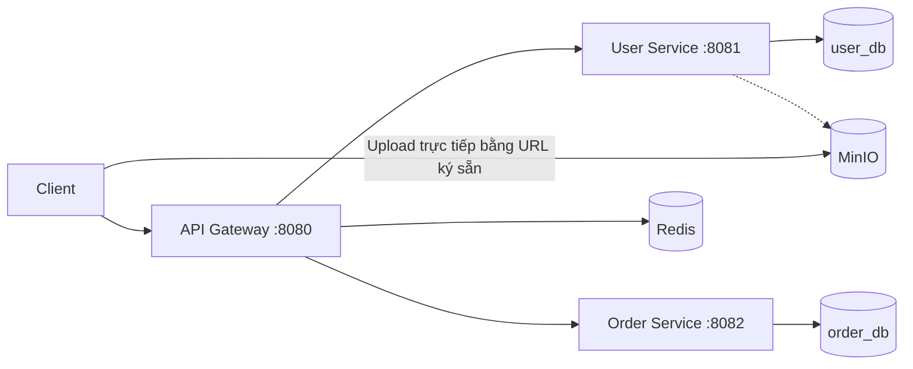

# API Gateway Lab

Bài thực hành **Microservices + API Gateway** với hai service độc lập: **User** và **Order**. Gateway xử lý định tuyến, xác thực JWT, giới hạn request và tổng hợp dữ liệu.

## Công nghệ và kiến trúc

- **Java 21**, **Spring Boot 4.0.9**, **Spring Cloud Gateway 5.0.2** (Spring Cloud 2025.1.2).
- **PostgreSQL 17**: hai database riêng `user_db` và `order_db`; **Flyway** quản lý schema.
- **Redis 7.4**: giới hạn **10 request/giây** bằng token bucket.
- **MinIO**: lưu avatar qua **pre-signed PUT URL**, hết hạn sau **300 giây**.
- **Docker Compose**: chạy Gateway, User Service, Order Service, PostgreSQL, Redis và MinIO.



Project Spring Boot ở **thư mục gốc** là Gateway; `user-service/` và `order-service/` là hai ứng dụng Maven độc lập.

## Chạy hệ thống

Yêu cầu: **Docker Desktop** (Linux containers). Nếu chạy kiểm thử Python, cần Python 3.10+; nếu build Java bên ngoài Docker, cần JDK 21.

Mở **PowerShell trong thư mục `apigatewaylab`**:

```powershell
# Chỉ tạo .env nếu chưa có
if (!(Test-Path '.env')) { .\tests\New-LabEnv.ps1 }

# Dùng cấu hình kiểm thử nếu cổng PostgreSQL 5435 đang bị chiếm
# (PostgreSQL trên host chuyển sang 15435)
docker compose -f docker-compose.yml -f tests/docker-compose.test.yml up -d --build --wait --wait-timeout 240
docker compose -f docker-compose.yml -f tests/docker-compose.test.yml ps
```

Nếu cổng **5435** đang trống, có thể dùng cấu hình mặc định: `docker compose up -d --build --wait --wait-timeout 240`.

| Dịch vụ | Địa chỉ trên máy |
|---|---|
| API Gateway | `http://localhost:8080` |
| User / Order Service (kiểm thử trực tiếp) | `http://localhost:8081` / `http://localhost:8082` |
| PostgreSQL | `localhost:5435` (mặc định) hoặc `localhost:15435` (override) |
| Redis | `localhost:6379` |
| MinIO API / Console | `http://localhost:9000` / `http://localhost:9001` |

> Các cổng chỉ mở trên `127.0.0.1`. Lần build MinIO đầu tiên cần Internet. Không commit `.env` lên Git.

## API chính

| Endpoint qua Gateway | Chức năng |
|---|---|
| `POST /auth/register` | Đăng ký tài khoản |
| `POST /auth/login` | Đăng nhập bằng **username**, nhận JWT |
| `GET /users/me` | Xem hồ sơ |
| `POST /users/avatar/upload-url` | Lấy URL upload avatar (300 giây) |
| `POST /orders` | Tạo đơn hàng |
| `GET /orders/me` | Xem đơn hàng của mình |
| `GET /orders/{id}` | Xem chi tiết đơn hàng thuộc tài khoản |
| `GET /dashboard` | Tổng hợp thông tin user và danh sách orders |

Các API ngoài đăng ký/đăng nhập yêu cầu `Authorization: Bearer <JWT>`. Gateway xác thực JWT; service nội bộ còn kiểm tra khóa nội bộ. Rate limiter dùng Redis, trả **429** khi vượt giới hạn.

### Demo nhanh bằng PowerShell

```powershell
$base = 'http://localhost:8080'
$username = 'demo' + (Get-Date -Format 'yyyyMMddHHmmss')
$password = 'Demo@123456'

$register = @{ username=$username; email="$username@example.com"; password=$password } | ConvertTo-Json
Invoke-RestMethod "$base/auth/register" -Method Post -ContentType 'application/json' -Body $register

$login = @{ username=$username; password=$password } | ConvertTo-Json
$auth = Invoke-RestMethod "$base/auth/login" -Method Post -ContentType 'application/json' -Body $login
$headers = @{ Authorization="Bearer $($auth.accessToken)" }

Invoke-RestMethod "$base/users/me" -Headers $headers
$order = @{ productName='Keyboard'; quantity=2; totalAmount=500000 } | ConvertTo-Json
Invoke-RestMethod "$base/orders" -Method Post -Headers $headers -ContentType 'application/json' -Body $order
Invoke-RestMethod "$base/dashboard" -Headers $headers | ConvertTo-Json -Depth 10
```

### Upload avatar lên MinIO

```powershell
$upload = Invoke-RestMethod "$base/users/avatar/upload-url" -Method Post `
  -Headers $headers -ContentType 'application/json' -Body '{"contentType":"image/png"}'

# Thay bằng đường dẫn tới file PNG có thật trên máy
Invoke-WebRequest -Uri $upload.uploadUrl -Method Put `
  -InFile 'C:\images\avatar.png' -ContentType 'image/png'
```

Client upload **trực tiếp lên MinIO**, không gửi file qua Gateway. Có thể kiểm tra object trong MinIO Console (`localhost:9001`).

## Build, kiểm thử và benchmark

```powershell
.\tests\Build-Lab.ps1
python .\tests\integration.py
python .\tests\integration.py --verify-expiry  # Kiểm tra URL hết hạn sau 5 phút
python .\tests\benchmark.py --samples 100 --warmup 10 --rps 4
```

Kết quả đã ghi nhận: **18 JUnit tests đạt**, **4 nhóm integration tests đạt**; benchmark local có **100% request thành công**, overhead trung bình qua Gateway khoảng **8,6–8,8 ms**. Xem số liệu Average/P50/P95, điều kiện đo và giới hạn phép thử tại **[tests/VERIFICATION.md](tests/VERIFICATION.md)**.

Để xem log hoặc dừng stack đang chạy với override:

```powershell
docker compose -f docker-compose.yml -f tests/docker-compose.test.yml logs --tail 100 api-gateway user-service order-service
docker compose -f docker-compose.yml -f tests/docker-compose.test.yml down
```

`down` không xóa named volumes. Nếu cần đổi mật khẩu đã dùng với database đang có dữ liệu, phải cập nhật cả thông tin xác thực trong PostgreSQL, không chỉ sửa `.env`.
